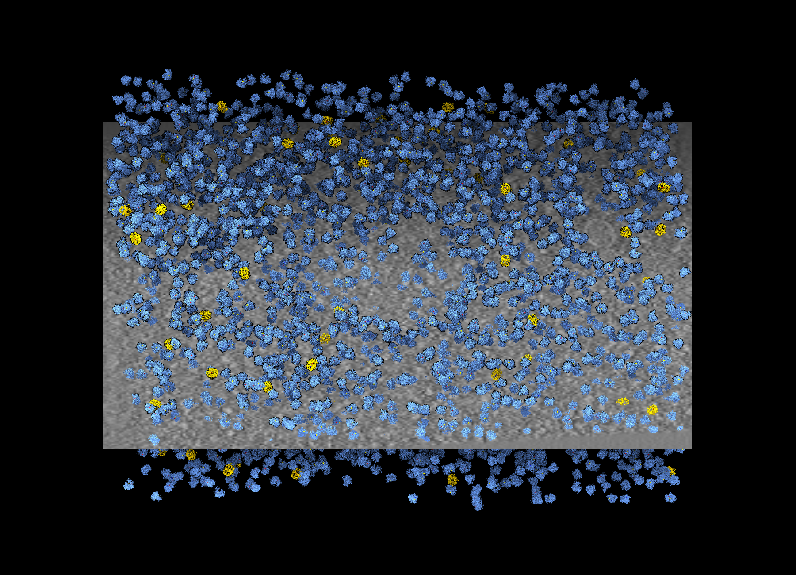
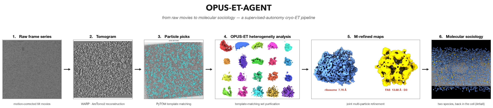
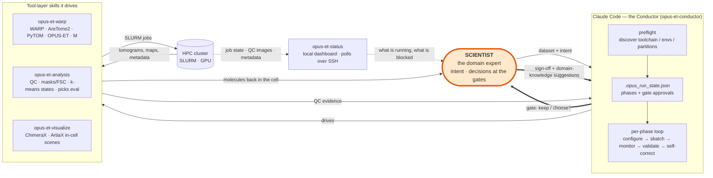
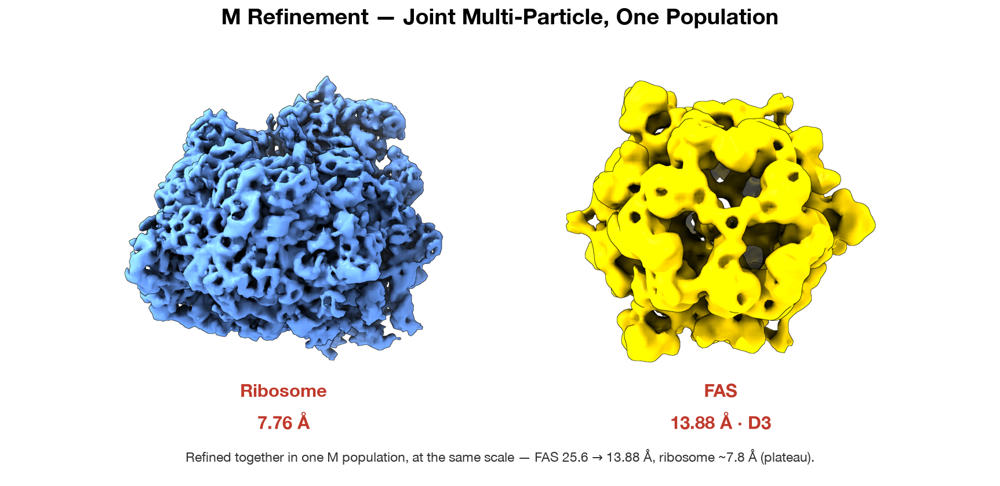
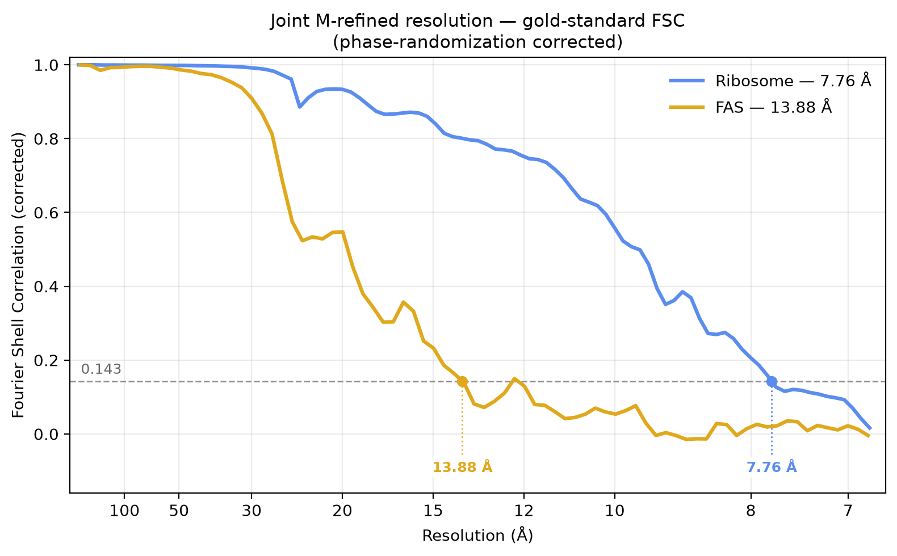
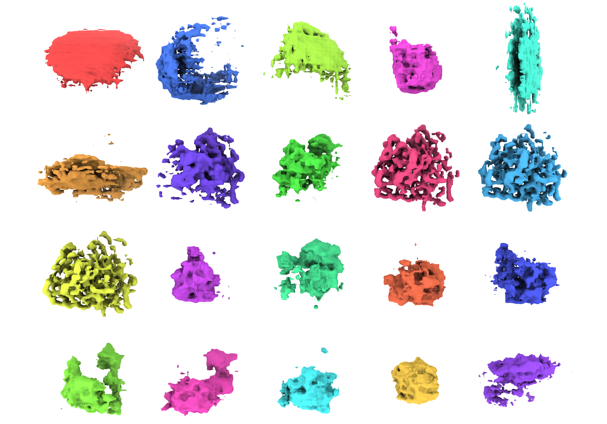
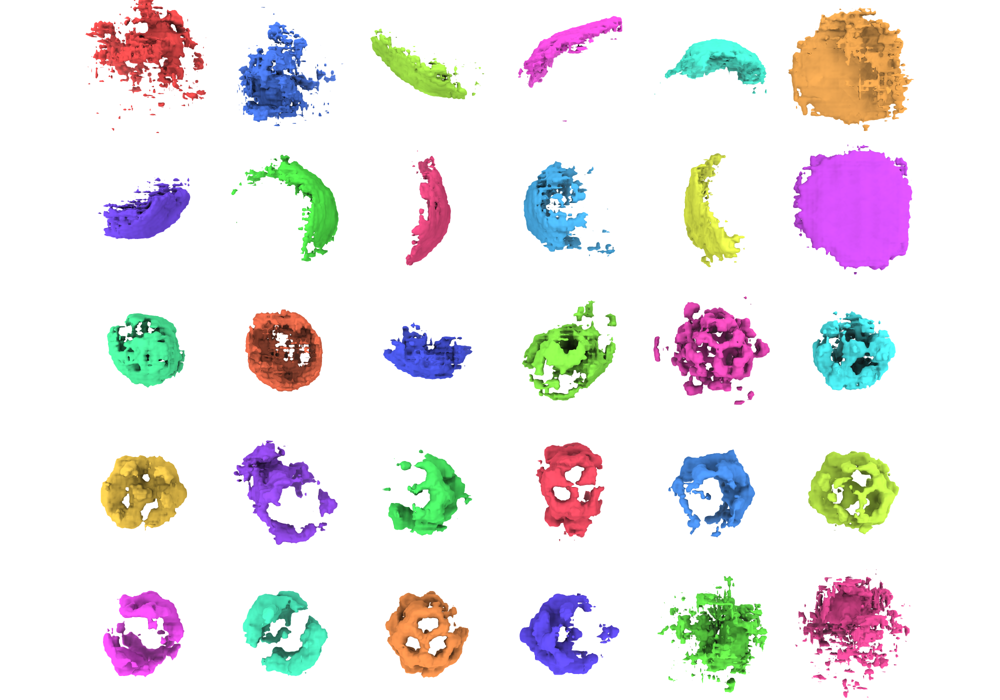

<p align="center">
  <br>
  <sub><em>Claude Code — your resident cryo-ET conductor, at the bench.</em></sub>
</p>

# OPUS-ET-AGENT — agentic cryo-ET pipeline

A supervised-autonomy **conductor** (Claude Code) that drives the cryo-ET reconstruction
pipeline end-to-end — **WARP → AreTomo2 → PyTOM → OPUS-ET → M** — pausing at each scientific
**gate** for a human sign-off, self-correcting known failures, and mapping the refined molecules
back **inside the cell** (ChimeraX/ArtiaX). Built on top of a set of great cryo-ET data-processing
software — **WARP/M**, **AreTomo2**, **PyTOM**, **OPUS-ET**, **ChimeraX**, and **ArtiaX**.

<p align="center">
  <br>
  <sub><em>The payoff — every ribosome (blue) and fatty-acid synthase (gold) placed back at its pose inside one real cell: <b>molecular sociology</b>, read straight off the data.&nbsp; ▶ <a href="demo/README.md#gate5">watch it rotate</a></em></sub>
</p>

<p align="center">
  <a href="https://www.youtube.com/watch?v=Kf_MkRYBOCo"></a><br>
  <sub><em>▶ <a href="https://www.youtube.com/watch?v=Kf_MkRYBOCo"><b>Watch the demo walkthrough</b></a> — Claude Code drives the full cryo-ET pipeline end-to-end, pausing at each human gate for sign-off.</em></sub>
</p>

## The task — and why it matters

**Cryo-electron tomography (cryo-ET)** is the only technique that resolves macromolecules at
near-molecular detail *inside intact cells* — structural biology *in situ*, where you see not just
a molecule's shape but **where it sits and who it sits with** ("molecular sociology"). Getting
there means turning raw tilt-series — dose-fractionated movies of a frozen cell tilted in the
microscope — into 3D density maps of the molecules within: motion/CTF correction, tilt-series
alignment, tomogram reconstruction, particle picking, per-particle heterogeneity analysis, and
multi-particle refinement. That pipeline is long and fragile, spans half a dozen specialist
packages, and is gated by expert judgment at nearly every step — which is why in-cell structural
biology stays expensive and low-throughput.

**This project puts an AI agent in the driver's seat.** Claude Code runs the whole chain
end-to-end with *supervised autonomy*: it discovers the toolchain, configures and submits the
cluster jobs, runs the QC at each stage, and — crucially — **stops at each scientific checkpoint
and hands the decision to a human**, backing that decision with the evidence it computed. The
payoff is in the results: on a real dataset ([EMPIAR-10988](https://www.ebi.ac.uk/empiar/EMPIAR-10988/))
it drove **two** molecular species to high resolution at once — the **ribosome to 7.76 Å** and
**fatty-acid synthase to 13.88 Å** — and mapped both back into the cell as *molecular sociology*.
Why it matters: a weeks-long, expert-only workflow becomes a reproducible, test-covered,
agent-driven one that still keeps the scientist in command of every call that matters — and
mapping molecules back into the cell turns isolated structures into a map of *who sits next to
whom*, where the crowding, exclusion zones, and neighbour relationships that purified structures
can't show make subtler in-cell molecular mechanisms discoverable.

**The whole arc at a glance** — raw movies → tomogram → picks → OPUS-ET states → M-refined maps →
the two molecules mapped back into the cell:



## The gates

The agent runs the judgment-support work; the human holds the decision.

1. **Gate 1 — alignment QC** — one QC agent per tomogram (parallel), reconstruction slices + a
   WARP↔AreTomo handedness check.
2. **Gate 2 — picks QC** — template-matching picks scored + overlaid; runs on **two species**
   (ribosome and FAS) from one reconstruction set.
3. **Gate 3 — state selection** — OPUS-ET latent states judged by four converging, mostly
   template-free signals.
4. **Gate 4 — resolution** — gold-standard half-map FSC with the phase-randomization correction,
   plus a **mask–density overlay** that *shows* the mask wraps the molecule without clipping.
5. **Gate 5 — joint M refinement** — both species in one M population; multi-particle refinement
   solves the shared tilt-series model with every particle at once (**FAS 25.6 → 13.88 Å**).

## Components

- **opus-et-warp** — reconstruction engine (WARP / AreTomo2 / PyTOM / OPUS-ET / M), SLURM.
- **opus-et-analysis** — interpretation + QC tools (mask/FSC, k-means states, map consistency, pose parsing).
- **opus-et-conductor** — orchestration brain: run-state, checkpoints, monitor/diagnose loop.
- **opus-et-visualize** — in-cell ChimeraX/ArtiaX scenes (each map placed at every pose, colored by state/species).
- **opus-et-status** — local web dashboard: what is running, what failed, what is waiting on you.

## Architecture

Supervised autonomy: the conductor runs the machinery and computes the evidence; the scientist
makes every judgment call, at five gates.



**Gates:** 1 alignment QC · 2 picks QC · 3 state selection · 4 resolution · 5 joint-M refinement.

## Getting started

OPUS-ET-AGENT provides five skills for Claude Code or Codex. Describe your dataset to `opus-et-conductor` to run the pipeline and review the evidence at each scientific gate. The conductor coordinates `opus-et-warp`, `opus-et-analysis` and `opus-et-visualize`. Use `opus-et-status` to inspect progress.

**Prerequisites**
- An agent that runs the skills. Choose [Claude Code](https://code.claude.com/docs) or [Codex](https://developers.openai.com/codex/).
- **For a real run** — an HPC cluster (SLURM + GPUs) with the cryo-ET toolchain the skills drive: **WARP** (the [`alncat` fork](https://github.com/alncat/warp), required for `--dont_correct_ctf_3d` / `--output_ctf_csv`), **AreTomo2**, **PyTOM**, **OPUS-ET** (`dsdsh`), and **M** (`MTools` / `MCore`), each in its conda env. The conductor's preflight probes for these and reports whatever is missing — it does not install them.
- **For the in-cell finale** — a local **ChimeraX 1.10 + ArtiaX 0.7.0** desktop (the render runs locally, not on the cluster).

### Install and update with Git

From a checkout of this repository, run the installer once on your desktop. It detects installed clients. Use repeatable `--client codex`, `--client claude`, or `--client antigravity` to choose them explicitly.

```bash
git clone https://github.com/alncat/opus-et-agent.git
cd opus-et-agent
./tools/opus-et install
```

The installer puts `opus-et` in `~/.local/bin`. Add that directory to your shell's `PATH` or use the full path. From then on, run these commands from any directory, including a client's terminal:

```bash
opus-et update                 # update this machine from GitHub main
opus-et status                 # show installed revisions on this machine
opus-et update --remote super  # deploy the same commit to the SSH host
opus-et status --remote super  # verify desktop and cluster installations
```

The updater keeps its own Git checkout under `~/.local/share/opus-et/`. Codex and Claude skills link to the active release. Antigravity receives a complete plugin in its global plugin directory. When the Codex CLI is available, the installer registers the desktop MCP server and, with `--remote`, the SSH connection. An existing MCP entry with a different launch command is reported for review. Open a fresh client session after updating. [Antigravity global plugin directory](https://antigravity.google/docs/plugins/#manual-plugin-installation)

For a cluster install, supply the SSH alias on either `install` or `update`. Only the desktop fetches Git. The cluster receives a checksum-verified bundle, updates its stable MCP path, and links the five skills for Codex and Claude. Existing Agents and Kimi installations on that host are also migrated. Matching skill directories are backed up under `~/.local/share/opus-et/backups/` before conversion. If a copy has local changes, the updater identifies the directory so you can review or move it and retry. `status` checks installed files and identifies modified, missing or mixed installations.

### Manual Claude Code setup

Clone the repo and make the five skill directories discoverable by Claude Code — a skill is just a folder with a `SKILL.md`, auto-discovered from `.claude/skills/` (this project only) or `~/.claude/skills/` (everywhere). No registration step. Symlink (shown) or copy all five in together: status imports conductor from the sibling directory, and the shared agent rules ship in the conductor’s references directory. Demo assets remain in the cloned repository.

```bash
git clone https://github.com/alncat/opus-et-agent.git
cd opus-et-agent
mkdir -p .claude/skills
for s in opus-et-conductor opus-et-warp opus-et-analysis opus-et-visualize opus-et-status; do
  ln -s "../../$s" ".claude/skills/$s"   # or: cp -r "$s" ".claude/skills/$s"
done
```

### Manual Codex setup

From the root of your local OPUS-ET checkout, link the five skills so Codex can use them from any dataset directory. For a project-only install, set `skill_dir` to that project's `.agents/skills` directory. [Codex skill discovery](https://developers.openai.com/codex/skills/)

```bash
repo=$(git rev-parse --show-toplevel)
skill_dir="$HOME/.agents/skills"
mkdir -p "$skill_dir"
for skill in opus-et-conductor opus-et-warp opus-et-analysis opus-et-visualize opus-et-status; do
  ln -s "$repo/$skill" "$skill_dir/"
done
```

To use the MCP tools from desktop Codex, register the local server for visualization and the SSH server for cluster work. Run these commands from the checkout on your desktop. The `super` command uses the deployed plugin and an explicit Python path because its non-interactive SSH shell has no `python3` on `PATH`. For another cluster, substitute its SSH alias, interpreter and plugin path. [Codex MCP configuration](https://developers.openai.com/codex/mcp/)

```bash
codex mcp add opus-desktop -- python3 "$PWD/.agents/plugins/opus-et/scripts/mcp_server.py" --role desktop
codex mcp add opus-super -- ssh -T super '~/.local/share/uv/tools/kimi-cli/bin/python ~/.agents/plugins/opus-et/scripts/mcp_server.py --role cluster'
codex mcp list
```

Open a new Codex session and select `$opus-et-conductor`. To verify the connection against an existing run, give it the absolute project path on the cluster:

> Use $opus-et-conductor and the opus-super connection to read the existing run state at `<cluster project path>`. Report the execution host and the latest checkpoint. Keep this check read-only.

### Manual Antigravity setup

**Standalone Antigravity plugin.** From the checkout, run `python3 tools/build_antigravity_plugin.py dist/opus-et.zip`. The ZIP contains the MCP server, submission hook, shared rules and all five skill directories. Extract it into an empty directory before installing it on another machine. Set `OPUS_ET_PYTHON` to the scientific environment’s Python executable for NumPy-backed training configs, FSC and visualization.

**Desktop and cluster MCP connections.** The default connection runs all tools on one machine. For a desktop plus `super`, extract the same ZIP on each host and configure two connections as below. Replace the example install paths with the actual directories. Configure `OPUS_ET_PYTHON` on the host running the scientific tool.

```json
{
  "mcpServers": {
    "opus-desktop": {
      "command": "python3",
      "args": ["/absolute/local/opus-et/scripts/mcp_server.py", "--role", "desktop"]
    },
    "opus-super": {
      "command": "ssh",
      "args": ["-T", "super", "python3 /absolute/cluster/opus-et/scripts/mcp_server.py --role cluster"]
    }
  }
}
```

Preflight, project state, checkpoint decisions and validation belong to the cluster connection. Scene generation belongs to the desktop connection. Both can run analysis on locally accessible data. The handshake and tool results report the execution hostname. Supply that name as `expected_host` when an operation must run on a particular host. The SSH alias can differ from the login node’s hostname.

For a checkpoint decision, the server asks the scientist through the MCP client's confirmation form. The record includes the supplied reviewer name, decision time and confirmation channel. Clients without form support can open the checkpoint. The scientist then runs `python3 /path/to/opus-et-conductor/scripts/run_state.py confirm "$WORK_DIR" <gate>` in an interactive terminal on the project host.

### Start a run

Open Claude Code or Codex in your working directory and give the conductor the dataset location.

> *"I have a cryo-ET dataset to process end-to-end, on my `<cluster>` cluster; frames + acquisition MDOCs are under `<DATA_DIR>`. Use the OPUS-ET conductor: preflight the toolchain, auto-detect the acquisition parameters, write and validate `pipeline.conf`, and begin the pipeline — pausing at each scientific checkpoint for my sign-off."*

Progress lives in `.opus_run_state.json`, so a fresh session can resume from disk. The [per-gate runbook](opus-et-conductor/references/demo_recording.md) gives the prompt for each checkpoint.

**Watch the run in a browser.** A pipeline run is hours of SLURM jobs, so `opus-et-status` puts the run's state on one page. It is stdlib-only Python — nothing to install, and nothing left running on the cluster:

```bash
python3 opus-et-status/scripts/status_server.py \
    --host <CLUSTER_HOST> --work-dir <RUN_DIR> --port 8080
```

Then open <http://127.0.0.1:8080>. `--host` is any SSH alias that already works without a password prompt; `--work-dir` is the run directory on the cluster. Where `python3` is not on `PATH` in a non-interactive shell, pass the environment prelude:

```bash
--remote-init 'source ~/.bashrc && conda activate <env>'
```

Nine tabs, in pipeline order: **Run** (gates, phases, SLURM jobs, log tails), **Frames** (per-movie CTF quality, dose, tilt-series alignment), **Dataset**, **Visual QC** (browse the QC images, or render new slices and pick overlays on demand), **Training**, **Inventory** (template-matching scores and the particle funnel), **Refinement** (gold-standard FSC), **Config** (allowlisted, type-checked edits to the tuning knobs) and **Runs**.

Everything shown is read from what the pipeline already wrote — WARP's `processed_items.json`, PyTOM's particle XML, the acquisition MDOCs, AreTomo's `.aln` files and the run's own `logs/` — so routine polling does not rerun processing. Generating missing thumbnails requires Pillow on the cluster login node; on-demand scientific rendering requires the remote dependencies listed in `opus-et-status/references/panels.md`. The server binds `127.0.0.1` and has **no authentication**: keep it local.

**Try it without a cluster.** The QC / analysis / viz tools are plain Python and test-covered — run the suite and browse the results bundle:

```bash
python3 -m venv .venv && .venv/bin/pip install -r requirements-dev.txt
.venv/bin/pytest          # run the complete regression suite
```

[`demo/README.md`](demo/README.md) tells the figure-by-figure scientific story.

## Results & demo

**Two molecules, resolved together and mapped back into the cell.** With one config change and no new code, the same pipeline drove a ribosome to **7.76 Å** and the far rarer fatty-acid synthase to **13.88 Å**, refined jointly in a single M population. *(Click any figure to jump to its full write-up in the [results bundle](demo/README.md).)*

<p align="center">
  <a href="demo/README.md#gate5"></a><br>
  <a href="demo/README.md#gate5"></a>
</p>

At **Gate 3**, OPUS-ET's latent space is clustered into 20 compositional states; the agent brings four converging, mostly template-free signals to name the genuine high-resolution core instead of trusting one biased score:

<p align="center">
  <a href="demo/README.md#gate3"></a>
</p>

The **same workflow generalizes to a second species, zero code changes.** Fatty-acid synthase is far sparser, so its latent space is clustered into 30 states — most are junk, and the clean **D3 barrels** (with their 3-fold central pore) stand out as the real high-resolution population:

<p align="center">
  <a href="demo/README.md#gate3b"></a><br>
  <sub><em>The rarer molecule, same honest playbook — see the D3 barrels emerge from the junk clusters. <a href="demo/README.md#gate3b">Full write-up →</a></em></sub>
</p>

- **[demo/README.md](demo/README.md)** — the curated results bundle (Gates 1–5), figure by figure.

## Future directions

**State-resolved molecular sociology.** OPUS-ET's distinctive power is resolving each particle's
conformational/compositional **state**; the natural next step is to carry that per-particle state
into the in-cell map — colouring every placed molecule not just by *where* it sits but by *what
functional state it's in there*. Combining position with state turns the finale from a map of
locations into a map of *behaviour* — which ribosomes are actively translating and where, which
assemblies are engaged vs. idle — the biological context you can only read when you know both a
molecule's place and its state. Deeply integrating OPUS-ET this way is how OPUS-ET-AGENT delivers
progressively richer biological context over time.

## Acknowledgements

- **Anthropic** — for sponsoring this hackathon and for Claude; Claude Code drove the entire
  pipeline and built every tool here.
- **MRICS** — for the HPC compute this work ran on.
- **J. Mahamid lab** — for the cryo-ET dataset ([EMPIAR-10988](https://www.ebi.ac.uk/empiar/EMPIAR-10988/)).
